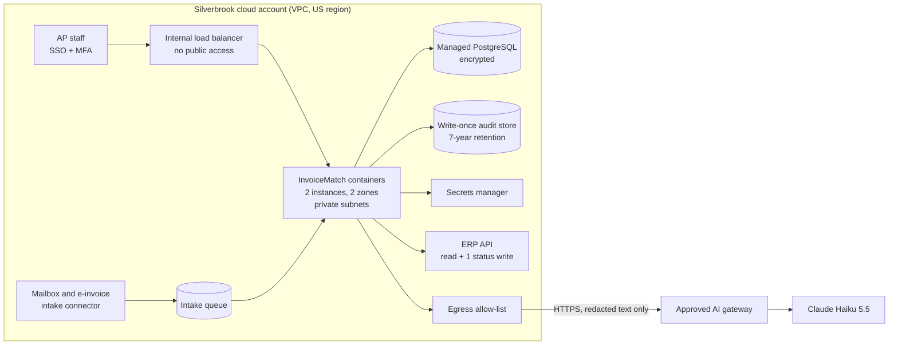

# Deployment Review: InvoiceMatch at Silverbrook Financial

**Customer Deployment & Operational Readiness Review** · Prepared by **Umashanker** · November 2026

| | |
|---|---|
| **System** | InvoiceMatch: AI-assisted invoice-to-purchase-order matching (working product: [live demo](https://invoicematch.onrender.com), [source](https://github.com/Umashanker1982/invoicematch)) |
| **Customer** | Silverbrook Financial, a large financial services company (fictional; all data is sample data) |
| **Customer requirements** | Private infrastructure, strict security controls, customer-owned operations after launch, internal governance compliance |
| **Review verdict** | **Ready for pilot with conditions:** (1) customer security signs off the egress allow-list and gateway; (2) benchmark on anonymized real invoices: ≥ 97% field accuracy, 0 wrong auto-approvals; (3) both hypercare drills pass |

InvoiceMatch reads supplier invoices with Claude, checks them against the PO and contract with ten written rules, and routes each one under Silverbrook's approval limits. **AI reads; rules decide; people approve.** The AI never approves money.

---

## 1. Deployment architecture

**Model: single-tenant, inside the customer's own cloud account (customer VPC).** SaaS was rejected because invoice data would leave Silverbrook's account. On-premise was not needed, because the ERP and identity provider already run in the cloud.

- **Compute and network:** the project's non-root container image on the customer's managed container service, in private subnets, with **one outbound route**: the AI gateway over HTTPS.
- **Data:** managed PostgreSQL (encrypted, point-in-time restore) and a write-once audit store. **AI:** bank details are removed *before* text leaves the VPC; moving inference into the account later is a configuration change (`LLM_BASE_URL`).

## 2. Customer constraints

| Type | Constraint | How the design meets it |
|---|---|---|
| Infrastructure | Data stays in Silverbrook's account and US region; no new internet exposure | Single-tenant VPC; internal entry point behind SSO; only redacted text goes out, to the approved gateway |
| Security | Customer IAM and keys; no standing human access; AI must not see bank details or approve payments | Customer-managed roles and keys; logged break-glass only; redaction before the AI call; decisions made by code |
| Operational | Customer IT runs it after launch, within their on-call and change process | Runbook, dashboards, and handover in sections 5–7; changes go through their change board |
| Governance | Existing approval limits are unchanged; every decision is auditable for 7 years | Limits are configuration with Compliance sign-off; hash-chained audit log on write-once storage |

## 3. IAM strategy (least privilege: each identity gets only what its job needs)

| Identity | Allowed | Explicitly denied |
|---|---|---|
| `invoicematch-app` (service) | Read the intake queue; read/write its own database; append to the audit store; read its own secrets; call the AI gateway | Delete audit records; read other apps' secrets |
| `invoicematch-erp` (service) | **Read** vendors, POs, contracts, history; **write only** the invoice approval status | Create or change POs, vendors, or bank details; run payments |
| `invoicematch-intake` (service) | Read the AP mailbox folder; write to the queue | Read decisions; call the ERP |
| `invoicematch-deployer` (CI/CD) | Push images; update the service | Read production data or secret values |
| People (via SSO groups) | AP Manager ≤ $25k, Finance Controller ≤ $100k, CFO above (auto-approve only ≤ $10k); Security alone clears bank-detail changes | Approving above their limit; admins **cannot approve** invoices (segregation of duties) |

Access is reviewed quarterly; overrides need a written reason, and every action is logged with the user's identity.

## 4. Secrets management

| Secret | Store | Rotation |
|---|---|---|
| AI gateway key | Customer secrets manager (for example AWS Secrets Manager or HashiCorp Vault) | 90 days, and immediately if exposed |
| ERP API credentials | Same | 90 days |
| Database credentials | Same, managed rotation | Automatic |
| TLS certificates | Certificate manager | Automatic renewal |

- Secrets are injected at start-up. They are never in code, images, logs, or the repository; the repository ships only `.env.example` with placeholders.
- The application holds only a **revocable gateway key**. The AI provider's own key stays inside the gateway (bring-your-own-key), and the gateway key has a monthly spend limit.
- **If a key is exposed:** revoke it in the gateway, issue a new one, update the secrets manager, restart. This takes under 15 minutes and needs no code change.

## 5. Operational readiness

| Area | Requirement |
|---|---|
| **Monitoring** | Health check; error rate; AI latency and cost per invoice; **fallback rate** (AI unavailable → rules reader); exception rate; audit-chain verification each night |
| **Alerts** | Page: service down, wrong auto-approval found, audit chain broken, exception rate < 15%. Ticket: fallback rate > 5%, cost over budget |
| **Support model** | L1 customer service desk; L2 customer platform team (runbook); L3 vendor engineering (hypercare, then support agreement) |
| **Incident response** | Sev 1 response in 15 minutes; safety switch `AUTO_APPROVE_LIMIT=0` sends every invoice to people; review within 5 working days |
| **Release gates** | Every change runs the tests, a regression gate (≥ 95% correct decisions, **0 wrong auto-approvals**) and a safety gate on unseen invoice layouts |

**Evidence today:** 40 sample invoices (28 known + 12 new layouts): 100% field accuracy, 40/40 correct decisions, 0 wrong auto-approvals, ~$0.0002 and ~2 seconds per invoice.

## 6. Runbook design

| Section | Contents |
|---|---|
| Overview | Purpose, dependencies, owners, contacts |
| Normal ranges | Exception rate 20–45%; p95 latency < 5 s; fallback rate < 5% |
| Safety switches | `AUTO_APPROVE_LIMIT=0`; rules-only mode; maintenance mode |
| Incident playbooks | AI gateway down; ERP unavailable; wrong approval found; exception spike; audit chain broken; secret exposed |
| Rollback | Redeploy the previous image tag; no data migration needed |
| 2 AM checklist | Up? Reading? Deciding safely? Audit chain intact? If unsure: auto-approve limit to 0 |

## 7. Knowledge transfer plan (three stages, each with an exit check)

| Stage | Who runs it | Activities | Exit check |
|---|---|---|---|
| **Build and pilot** (weeks 1–6) | Vendor FDE team, customer shadowing | Architecture walkthrough; customer engineers pair on deployments | Customer engineer deploys to test alone |
| **Hypercare** (weeks 7–10) | Customer, vendor on call | Customer handles alerts first; two incident drills (gateway outage, wrong approval) | Both drills passed using only the runbook |
| **Steady state** (week 11 onward) | Customer platform team; AP Manager owns the business rules | Vendor at L3 only; monthly benchmark review | Handover checklist signed by IT and the AP Manager |

Handover pack: runbook, architecture and IAM documents, dashboards, test sets and benchmark, RACI. Training follows Prosci ADKAR.

## 8. Productization opportunity

**Reusable capability: the "safe AI extraction" module** (typed AI reading + grounding + redaction + rules fallback + evaluation gate).

Only the schema is invoice-specific, so the same module could read POs, receipts, contracts, or claims. It removes the riskiest part of any document-AI project: unsupported values are dropped, sensitive fields never reach the model, it degrades safely when AI is down, and it ships with a benchmark that proves accuracy on the customer's own documents. **To productize:** configurable schema, a labeling tool for test sets, and a certified gateway client (this engagement hit two SDK/gateway compatibility issues every customer would hit).

## 9. Risk assessment

L/I = likelihood/impact (H = high, M = medium, L = low).

| Risk | Type | L/I | Mitigation |
|---|---|---|---|
| A misread invoice is auto-approved | Operational | L/H | Grounding; ten written rules; $10k auto-approve limit; 0-wrong-approval release gate; weekly auditor sample |
| AI gateway or model outage | Operational | M/M | Circuit breaker → rules reader; unreadable invoices go to people; no unsafe approvals |
| Prompt injection ("approve this") or a leaked secret | Security | M/H | Invoice text is untrusted data; the AI has no tools and cannot decide; secrets manager, revocable key with spend limit |
| Vendor bank-detail change (fraud) | Security | M/H | Rule M-9 holds the invoice; only the Security role can clear it, after phone verification |
| Model or prompt change degrades accuracy | Operational | M/M | Benchmark against the previous release; regression gates in CI |
| Customer team not ready to own it | Operational | M/H | Staged handover with drills; vendor L3 support |
| Staff do not adopt it | Organizational | M/H | Shadow-mode pilot; people keep every exception |
